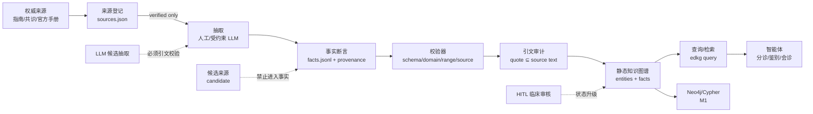

# ED-ConsultKG 构建方案

> 版本：v0.1（M0）｜日期：2026-10-29｜性质：可行性方案 + 已落地的最小可行版本说明
> 行为准则见 [`Agent.md`](../Agent.md)；变更记录见 [`DEVLOG.md`](../DEVLOG.md)；待办见 [`TODO.md`](../TODO.md)。

---

## 1. 目标与边界

### 1.1 目标

构建**流程感知、来源可审计、可增量扩展**的急诊全流程会诊知识图谱（ED-ConsultKG），覆盖：

- 流程：分诊 → 检查检验 → 鉴别诊断 → 多学科会诊 → 处置 → 转归；
- 临床：主诉、疾病/综合征、症状/体征/红旗、检查、治疗、危险因素、分诊量表；
- 组织：科室、会诊角色、胸痛中心等协作流程、就诊分区、处置去向。

最终支撑智能体在急诊场景中的：分诊候选指标提示、高危鉴别、检查建议、会诊/转诊路径、处置去向，并保证每条知识可追溯到原文。

### 1.2 非目标（M0）

- 不是临床决策系统；所有输出仅供研究，必须由医生复核。
- 不做完整 30+ 病种/10 万实体；M0 只做胸痛一个主诉。
- 不做 ESI 四级/五级映射、不做 ICD 编码批量对齐、不做 MIMIC 数据。
- 不声称临床验证通过；M0 全部事实为 `ai-draft`。

---

## 2. 设计原则

1. **来源优先**：先有可核验来源，再有事实；没有来源的“常识”不进入图谱。
2. **流程感知**：Schema 预留 Visit/CareEvent 与六阶段；M1 起把流程事件实例化，而不是只做疾病分类树。
3. **provenance 一等公民**：每条事实携带来源、定位、原文引文、置信度、审核状态。
4. **静/动分层**：`verified` 静态可信层与 `candidate` 候选层隔离；候选来源不得进入事实。
5. **MVP 优先**：一个主诉、一个闭环、可验证；再逐步增加主诉/病种/规模。
6. **双格式可发布**：JSONL 为规范数据；M1 增加 Neo4j/Cypher 导出，RDF 后续。
7. **评估驱动**：每轮扩展都有质量门（校验、引文审计、抽检、下游查询测试）。

---

## 3. 总体架构



### 3.1 数据流

1. 来源进入 `data/registry/sources.json`，先 `candidate`；完成 HTTP/API/人工核验后改 `verified`。
2. 抽取者按章节摘取最短支撑句，写入事实的 `locator`/`quote`。
3. 校验器检查 Schema、domain/range、来源状态、provenance 完整性、重复三元组。
4. 引文审计抓取来源文本，检查 `quote` 是否为原文连续片段；不通过则修正/删除。
5. 通过后进入 `data/kg/`；查询 CLI 只读取通过校验的数据。
6. M1 起导出 Neo4j；M2 起接入 LLM 候选抽取与 HITL 队列。

### 3.2 事实生命周期

```mermaid
stateDiagram-v2
    [*] --> ai-draft
    ai-draft --> needs-review: 发现冲突/推断/低置信
    needs-review --> human-reviewed: 人类复核
    human-reviewed --> clinician-approved: 具名临床专家
    ai-draft --> deprecated: 指南更新/纠错
    needs-review --> deprecated
    clinician-approved --> deprecated
```

Agent 只能创建 `ai-draft`/`needs-review`；`clinician-approved` 只能由具名临床专家设置。

---

## 4. Schema v0.1

机器可读定义：[`schema/edkg.schema.json`](../schema/edkg.schema.json)。人读说明：[`docs/SCHEMA.md`](SCHEMA.md)。

### 4.1 三层

| 层 | 实体 | M0 状态 |
|---|---|---|
| 流程事件层 | `Visit`、`CareEvent` | 仅 Schema 预留；不写患者实例 |
| 临床语义层 | `ChiefComplaint`、`Condition`、`Finding`、`Test`、`Intervention`、`RiskFactor`、`TriageScale`、`TriageLevel` | 用于胸痛种子 |
| 组织资源层 | `Department`、`Role`、`CareProcess`、`CareArea`、`Disposition` | 胸痛中心/分区/去向 |

### 4.2 关系（M0 使用）

`MAY_INDICATE`、`PRESENTS_WITH`、`HAS_RED_FLAG`、`SUPPORTS`、`DIFFERENTIATED_FROM`、`DISTINGUISHED_BY`、`RECOMMENDED_TEST`、`TEST_YIELDS`、`TREATS`、`TYPICAL_DISPOSITION`、`HAS_RISK_FACTOR`、`CONSULT`、`HAS_LEVEL`、`LEVEL_CRITERION`、`ASSIGNED_TO`、`PARTICIPATED_BY`。

流程关系 `HAS_EVENT`、`NEXT_EVENT`、`USES_SCALE`、`HAS_CHIEF_COMPLAINT` 已定义，M0 不实例化。

### 4.3 provenance

每条事实必须有：`source_id`、`locator`、`quote`、`confidence`、`assertion_type`、`review_status`、`extracted_by`、`extracted_at`。可选：`rationale`、`conflict_group`、`valid_from`、`valid_to`、`notes`。

- `quote` 建议 ≤200 字，硬上限 300 字；只保留最小支撑片段。
- `confidence` 是抽取置信度，不是临床概率。
- M0 只允许 `assertion_type=explicit`。

### 4.4 明确不做

- 中国四级 ↔ ESI 五级映射：**不做**；两套量表分别建模。
- M0 的 ICD-10/ICD-11 编码：**留空**；M1 用已核验 WHO 来源再填。
- 病种级会诊科室：M0 只写来源明确的胸痛中心参与科室与转诊条件；专科会诊留给 M1。

---

## 5. 数据源策略

### 5.1 已核验、M0 可用的来源

| ID | 来源 | 访问 | 许可/再分发 | M0 用途 |
|---|---|---|---|---|
| `src.cn.chest_pain.2019` | 《急性胸痛急诊诊疗专家共识》，中华急诊医学杂志 2019;29(4):413-420，DOI 10.3760/cma.j.issn.1671-0282.2019.04.002 | 开放 HTML，HTTP 200 | 版权归中华医学会；仅短引文，不转载全文 | 胸痛病因、危险分层、检查、治疗、MDT |
| `src.cn.triage.2018` | 《急诊预检分诊专家共识》，中华急诊医学杂志 2018;27(6):599-604 | 开放 HTML，HTTP 200 | 同上 | 中国四级分诊、响应时限、分区 |
| `src.us.ahrq.esi.v4.2005` | AHRQ ESI v4 Implementation Handbook，Pub. No. 05-0046-2 | 开放 PDF，HTTP 200，463,412 bytes | 美国政府作品，公有领域 | **M1** 的 ESI 五级；M0 只登记 |

### 5.2 仅登记、M0 不用的来源

| ID | 来源 | 状态 | 原因 |
|---|---|---|---|
| `src.physionet.mimic_iv_ed.2.2` | MIMIC-IV-ED v2.2 | access_controlled | 需 CITI/DUA；不得进入公开图谱 |
| `src.github.ddxplus` | DDXPlus | candidate | 许可证未核验 |
| `src.github.triageagent` | TriageAgent | candidate | 无许可证文件 |
| `src.harvard.primekg` | PrimeKG | candidate | 版本/许可未核验 |
| `src.who.icd10.2019` | ICD-10 v2019 | candidate | M0 不给编码；待官方导出/许可核验 |

### 5.3 报告的处理

`docs/research/大规模急诊全流程会诊知识图谱研究报告.md` 是设计输入，不是数据源目录：

- 报告中的 arXiv/数据集引用**未逐条核验**；
- 不把报告中的数字（如某图谱规模、某模型指标）直接搬进图谱或 README 结论；
- 需要引用时，回到原始指南/登记页核验，并在 `sources.json` 留痕。

---

## 6. M0：胸痛最小可行版本

### 6.1 范围

- 1 个主诉：胸痛。
- 高危：急性冠脉综合征、急性心肌梗死、急性主动脉夹层、急性肺栓塞、张力性气胸。
- 中低危示例：稳定性冠心病、胃食管反流病、急性肋软骨炎、神经官能症。
- 分诊：中国四级标准（Ⅰ–Ⅳ + 非急症）、颜色、响应时限、分区、关键分级指标。
- 组织：胸痛中心 MDT（院前急救、急诊科、心内科）、不具备 PCI/大血管手术/引流能力时的转诊条件。
- 规模：80 实体、116 事实（目标 ≥40/≥60；实际以引文可核验为准）。

### 6.2 已实现内容

| 项目 | 位置 | 状态 |
|---|---|---|
| Schema v0.1 | `schema/edkg.schema.json` | 完成，校验通过 |
| 来源登记 | `data/registry/sources.json` | 3 verified / 1 access_controlled / 4 candidate |
| 实体 | `data/kg/entities.jsonl` | 80 |
| 事实 | `data/kg/facts.jsonl` | 116，全部 `ai-draft`，provenance 100% |
| 校验器 | `edkg/validate.py`、`python -m edkg validate` | 0 错误 0 警告 |
| 查询 CLI | `edkg/query.py`、`python -m edkg query --complaint 胸痛` | 可返回分诊指标、高危鉴别、检查、处置、MDT、证据 |
| 引文审计 | `scripts/audit_quotes.py` | 116/116 通过（2026-10-29） |
| 来源核验 | `scripts/verify_sources.py` | 3/3 开放来源 HTTP 200 |
| 测试 | `tests/` | 30 项通过 |
| CI | `.github/workflows/ci.yml` | 离线校验；运行状态以 Actions 为准 |

### 6.3 查询示例

```bash
python -m edkg query --complaint 胸痛
python -m edkg query --complaint 胸痛 --json
python -m edkg query --complaint 胸痛 --finding 类似心脏因素的胸痛
```

输出结构：分诊候选指标（不自动定级）→ 主诉级检查 → 各病种的表现/红旗/鉴别/检查/治疗/处置/危险因素 → 胸痛中心 MDT → 证据列表（source_id + locator + quote）。

### 6.4 M0 验收

- [x] 80 实体、116 事实，≥4 个高危病种；
- [x] provenance 100%，重复三元组 0；
- [x] 只引用 2 个 `verified` 中文共识；
- [x] 116/116 引文审计通过；
- [x] 查询 CLI 可回答胸痛分诊/鉴别/检查/处置/MDT；
- [x] 未知主诉明确报错；
- [x] 全部事实 `ai-draft`，未声称临床验证；
- [x] 远端 commit 与文档记录（见 DEVLOG）。

---

## 7. 建图流水线（M0 → M2）

### 7.1 M0：人工/受控抽取

- 人工按章节摘取事实与引文；
- 校验器 + 引文审计双门；
- 优点：可审计、可控；缺点：慢。

### 7.2 M1：半自动抽取

1. 以 Schema 生成 JSON 抽取模板；
2. LLM 分块抽取候选三元组 + 原文 span；
3. 规则：quote 必须能在原文匹配；否则丢弃；
4. 归一化：疾病/症状/检查同义词表；ICD/CMeKG 对齐需单独来源核验；
5. 候选进入 `needs-review` 队列，不直接进静态层；
6. 人工抽检 + 冲突检测。

### 7.3 M2：HITL 与动态层

- 专家审核界面/表格：逐条接受/修改/拒绝；
- 审核状态与审核人记录；
- 指南更新触发旧事实 `deprecated`；
- 动态候选层与静态可信层物理隔离（不同目录/不同图数据库 label）。

### 7.4 质量门

| 门 | 指标 | M0 | M1 目标 |
|---|---|---|---|
| Schema 校验 | 0 error | 通过 | 保持 |
| provenance | 100% | 100% | 100% |
| 引文审计 | 失败数 0 | 116/116 | 100% |
| 来源状态 | 事实只引 verified | 通过 | 保持 |
| 重复三元组 | 0 | 0 | 0 |
| 人工抽检 | 正确率 | 未做 | ≥90%（20 条样本） |
| 临床审核 | Kappa/通过率 | 未做 | 专家介入后报告 |

---

## 8. 评估方案

### 8.1 L1 建图质量（M0/M1）

- 正确性：分层随机抽 20–100 条事实，双人盲评“正确/部分正确/错误”；报告 P/R/F1、通过率、Cohen's Kappa。
- 覆盖率：目标主诉/病种/流程阶段是否都有事实；中文术语命中率（后续用 CCKS/CHIP 语料）。
- 一致性：矛盾三元组比例、重复率、孤立实体比例。
- 可追溯性：provenance 完整率、引文审计通过率。

### 8.2 L2 图谱任务（M1）

- 链接预测：MRR、Hits@1/3/10；按时间切片。
- 规则一致性：注入合成矛盾，测校验器/约束检出率。
- 检索质量：概念覆盖率、关系利用率、多跳路径相关性、引用保真度。

### 8.3 L3 下游临床任务（M2/M3，尚未开始）

- 分诊：MIMIC-IV-ED（需 DUA）、KTAS（若可得）、ESI 手册案例；指标 Accuracy/F1/QWK/MSE，另报 ESI-1/2 召回。
- 鉴别诊断：DDXPlus（先核验许可证）、CMB-Clin；指标 Acc@1/3/5、MRR。
- 会诊问答：自建 300–500 例场景（合成/改造病例，标明来源），测科室召回、路径可解释性、引用保真度。
- 对照：无检索 LLM、文档 RAG、通用图谱、MedRAG 等；必须分开报告“图谱收益”与“检索策略收益”。

### 8.4 统计与伦理

- 每组 ≥5 随机种子；配对 t/Wilcoxon；95% CI；多任务 Bonferroni。
- 人工评审盲法；Kappa ≥0.6 才采信。
- MIMIC 等受限数据只用于评测，不进公开图谱；涉及真实病历须伦理审查。
- 所有系统输出须医生复核；本仓库不提供临床建议。

---

## 9. 路线图

| 阶段 | 目标 | 规模目标 | 验收 |
|---|---|---|---|
| **M0（当前）** | 治理文档 + Schema + 胸痛 MVP + 校验/查询/审计/CI | 80 实体 / 116 事实 | 本页 6.4 全通过 |
| M1 | ESI 五级、ICD-10 编码、呼吸困难/腹痛/发热 3 主诉；Neo4j 导出；专科会诊（仅明确指南） | 300+ 实体 / 800+ 事实 | 两套量表独立可查；引文 100%；新增测试 |
| M2 | 10 主诉、30+ 高危病种；LLM 候选抽取 + HITL 队列；L1/L2 评估 | 2k+ 实体 / 8k+ 事实 | 抽检通过率 ≥90%；无候选来源进入事实 |
| M3 | 大规模扩展；GraphRAG/路径检索；DDXPlus/MIMIC 评测；论文产出 | 10k+ 实体 / 50k+ 关系 | 可复现实验、DUA/伦理合规、统计方案落地 |

规模是路线图目标，不是当前成果；不得用未核验数据凑数。

---

## 10. 仓库结构

```text
README.md                 项目入口
Agent.md                  行为准则
DEVLOG.md                 变更记录
TODO.md                   待办
LICENSE / NOTICE.md       许可与第三方声明
docs/
  PLAN.md                 本文件
  SCHEMA.md               Schema 人读说明
  MVP.md                  胸痛 MVP 说明
  research/               原始报告 + 图 + 引用警示
schema/edkg.schema.json   机器可读 Schema
data/registry/sources.json  来源登记
data/kg/entities.jsonl    实体
data/kg/facts.jsonl       事实
edkg/                     零依赖工具链（loader/validate/query/stats/CLI）
scripts/                  来源核验、引文审计
tests/                    单元测试与负例
.github/workflows/ci.yml  离线 CI
```

---

## 11. 风险与对策

| 风险 | 影响 | 对策 |
|---|---|---|
| 无临床专家 | 不能声称验证通过 | 全部 `ai-draft`；专家审核列 TODO 阻塞项；输出免责声明 |
| 指南版权 | 不能转载全文 | 只存短引文+定位；NOTICE 声明；不提交 PDF |
| LLM 幻觉 | 错误事实 | Schema 约束 + 原文引文 + `audit_quotes` + HITL；候选层隔离 |
| 报告引用不实 | 误导选题/数据 | 报告只作设计输入；回到原始来源核验；候选源不使用 |
| 分诊量表混用 | 错误分级 | 两套量表分开建模，禁止映射 |
| 规模压力 | 用未核验数据凑数 | 质量门优先；规模目标与当前成果分开写 |
| GitHub 传输受限 | 无法提交 | 优先 git；不可用时用 GitHub API；凭据不落盘；失败则停止并报告 |
| 许可证不明 | 法律风险 | `candidate` 隔离；使用前核验；不进入事实 |

---

## 12. 近期执行顺序

1. 保持 M0 的校验/测试/引文审计为每次提交门禁。
2. M1-01：核验 ESI v4 PDF 并抽取五级标准（单独量表，不做映射）。
3. M1-02：核验 WHO ICD-10 官方导出，填 `Condition.icd10`。
4. M1-03：新增呼吸困难/腹痛/发热 3 个主诉，逐病种补来源。
5. M1-04：Neo4j/Cypher 导出 + 10 个查询用例。
6. M1-05：M1 质量评估（20 条抽检 + 引文 100%）。
7. M2 起再考虑 LLM 抽取、HITL 与下游评测；任何一步都不得绕过 `Agent.md` 的红线。
