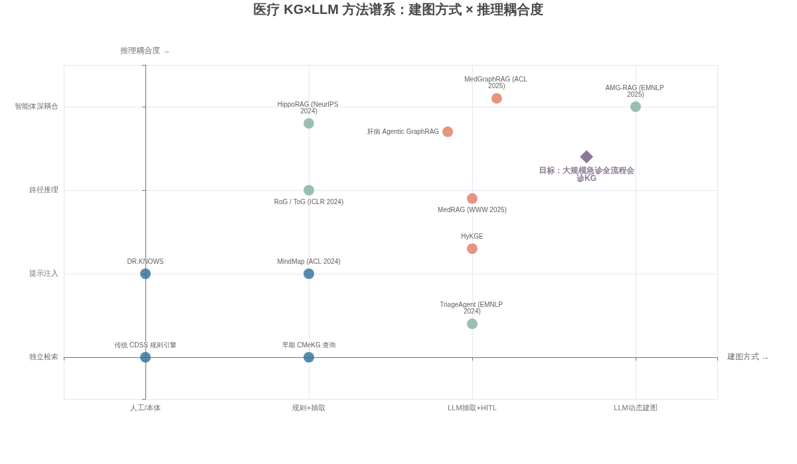
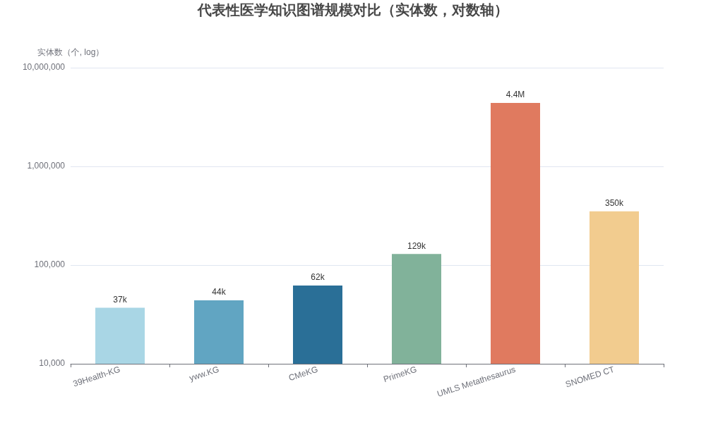
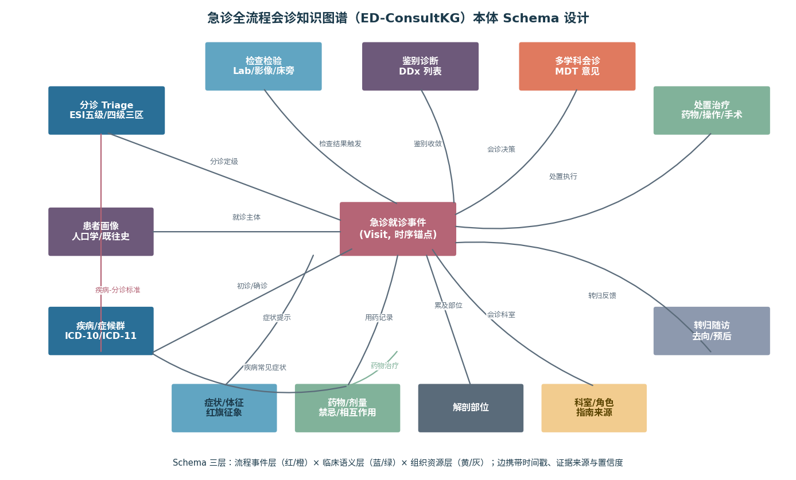
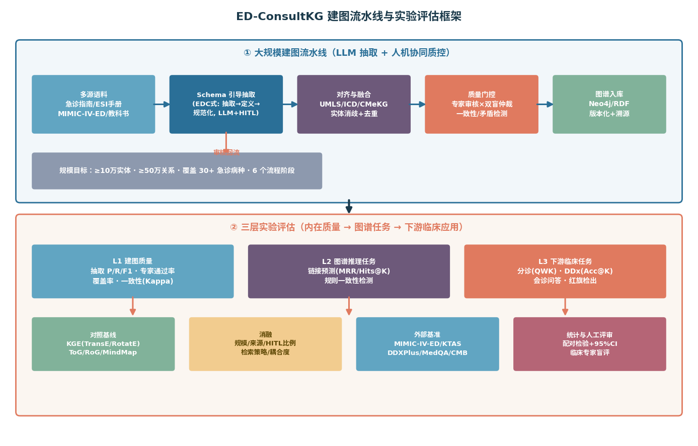

# 大规模急诊全流程会诊知识图谱研究报告
## ——研究现状、开源数据集、基线模型与论文实验设计

> 版本：v1.0　|　日期：2026-10-02　|　性质：深度研究报告（面向论文选题与发表）

---

## 1 摘要

本报告聚焦一个具有明确发表潜力的研究选题：**构建大规模急诊全流程会诊知识图谱（Emergency Department full-process Consultation Knowledge Graph，下称 ED-ConsultKG），并验证其对急诊智能分诊、鉴别诊断与多学科会诊的支撑能力**。急诊是医院中时间压力最大、信息最不完整、误诊代价最高的场景；而知识图谱（KG）与大语言模型（LLM）的融合正成为医疗 AI 的主流范式——2025 年的综述明确指出，LLM 正在把知识图谱从"静态符号结构"重塑为"可持续演化的认知基础设施"，本体工程、知识抽取、知识融合三个环节都在经历从规则流水线到生成式框架的范式转移（[arXiv](https://arxiv.org/html/2510.20345v1)）。

支撑证据链已经成形。在建图侧，肝病领域的 Agentic Graph RAG 工作证明了"LLM 抽取 + UMLS 对齐 + 专家人在环路（HITL）审核"流水线可以产出 12,192 实体、28,770 关系、经临床专家验证的高质量专科图谱（[PMC](https://pmc.ncbi.nlm.nih.gov/articles/PMC12748213/)）；GPT-4o 在医学本体映射任务上达到 93.75% 精确率与 96.26% F1，大幅超越传统 BERTMap 基线（[Frontiers](https://www.frontiersin.org/journals/artificial-intelligence/articles/10.3389/frai.2025.1546179/full)）。在推理侧，MedRAG（WWW 2025）用四层鉴别诊断知识图谱在 DDXPlus 上超越现有 RAG 方法（[arXiv](https://arxiv.org/abs/2502.04413)）；MedGraphRAG（ACL 2025）以 Triple Graph Construction 与 U-Retrieval 在 9 个医学问答基准上达到 SOTA（[arXiv](https://arxiv.org/abs/2408.04187)）；AMG-RAG（EMNLP 2025 Findings）用仅约 8B 参数的模型通过动态建图在 MedQA 上取得 74.1% F1，超过多个大其 10–100 倍的模型（[arXiv](https://arxiv.org/html/2502.13010v2)）。在急诊侧，基于分诊知识图谱的 GraphRAG 在急诊消息识别任务上达到 0.99 准确率、0.98 敏感度、0.99 特异度，显著优于无检索 LLM 与朴素 RAG（[PMC](https://pmc.ncbi.nlm.nih.gov/articles/PMC12089757/)）；TriageAgent（EMNLP 2024）用 ESI 手册 RAG + 多智能体讨论在三个分诊测试集上超越既有方法，并发布了首个带 ESI 标签的公开分诊基准（[GitHub](https://github.com/Lucanyc/TriageAgent)）。

然而，现有工作存在明显空白：**尚无一个覆盖"分诊—检查—鉴别诊断—多学科会诊—处置—转归"全流程、面向会诊场景组织知识、且公开可复现的大规模急诊知识图谱**。现有图谱要么是通用临床图谱（CMeKG 等，缺流程维度），要么是单病种专科图谱（肝病、阿尔茨海默），要么是流程数据不带知识组织（MIMIC-IV-ED）。本报告据此给出：（1）国内外近 2 年相关工作的系统梳理；（2）可直接使用的开源数据集与图谱资源清单；（3）近三年顶会顶刊基线模型的分层选型；（4）一份可直接执行的论文实验设计，含 Schema 设计、建图流水线、三层评估（建图质量/图谱任务/下游临床任务）、基线与消融、统计方案与发表路线建议。核心科学问题是：**流程感知的会诊知识图谱能否在保持可解释性的同时，系统性提升急诊分诊与鉴别诊断的准确性与安全性**。

---

## 2 国内外近 2 年相关工作

本章从三条线索展开：医疗知识图谱的构建范式演进、KG×LLM 推理方法、急诊场景的图谱与分诊应用。方法谱系总览见下图。

### 2.1 医疗知识图谱构建：从人工本体到 LLM 人机协同

医学知识图谱的经典资源以人工编纂本体为主。UMLS Metathesaurus 整合 200 余个词表、超过 440 万个概念，SNOMED CT 包含约 35 万个临床概念，二者长期是临床信息学的语义基座，但均受许可限制且更新缓慢（[PMC](https://pmc.ncbi.nlm.nih.gov/articles/PMC7971091/)）。中文侧，CMeKG 以 ICD、ATC、SNOMED、MeSH 等国际标准为骨架，整合临床指南、行业标准与医学百科，包含 6.2 万实体、37.4 万关系三元组，覆盖疾病、临床表现、部位、设备、操作、微生物、科室、检验、药物九类实体与 23 类关系（[arXiv](https://arxiv.org/pdf/2306.09968，)）；类似的还有从在线问诊网站构建的 yww.KG（4.4 万实体/29.4 万关系）与 39Health-KG（3.7 万实体/21 万关系）。生物医学侧，哈佛 Zitnik 实验室的 PrimeKG（Nature Scientific Data 2023）整合 20 个高质量数据源，覆盖 17,080 种疾病与 405 万条关系、10 个生物学尺度，并附带 Mayo Clinic、Orphanet、DrugBank 等权威临床文本描述，是目前开放程度最高的精准医学图谱之一（[Nature](https://www.nature.com/articles/s41597-023-01960-3)、[Harvard Dataverse](https://dataverse.harvard.edu/dataset.xhtml?persistentId=doi:10.7910/DVN/IXA7BM)）；其 2026 年的文献驱动扩展版 PrimeKG-Plus 进一步通过 Zenodo 发布（[bioRxiv](https://www.biorxiv.org/content/10.64898/2026.07.14.738415v1.full-text)）。

近两年建图范式的核心变化是 **LLM 驱动的自动化与人机协同质控**。EMNLP 2024 的 EDC（Extract, Define, Canonicalize）框架提出"抽取—定义—规范化"三阶段 LLM 建图流程，无需预定义 Schema 即可产出结构一致的三元组（[arXiv 引用页](https://arxiv.org/pdf/2603.10891)）。IJCAI 2025 的 LLM4VKG 探索用 LLM 构建虚拟知识图谱（[arXiv](https://arxiv.org/pdf/2603.10891)）。医学本体映射的系统评测表明，GPT-4o 将医学术语映射到 SNOMED CT 的精确率达 93.75%、F1 达 96.26%，相比 BERTMap 基线分别提升 44.91 与 38.33 个百分点，Llama 3.3 70B 与 DeepSeek R1 等开源模型也进入可用区间（[Frontiers](https://www.frontiersin.org/journals/artificial-intelligence/articles/10.3389/frai.2025.1546179/full)）。最具参考价值的工程样板是肝病 Agentic Graph RAG：从 53 部权威临床指南出发，用 GPT-3.5-Turbo 按预定义 JSON Schema（8 类实体、11 类关系）分块抽取，以 UMLS CUI 为主键做层级去重与关系聚合（如对 Disease-Drug 推荐关系自动计算平均权重并保留最强推荐级别），再经临床专家审阅修订后入库 Neo4j，最终形成 12,192 实体、28,770 关系的高质量专科图谱，并配套自动质控报告（[PMC](https://pmc.ncbi.nlm.nih.gov/articles/PMC12748213/)）。这条"**权威语料 → Schema 约束抽取 → 术语对齐融合 → 专家 HITL 门控 → 图数据库入库**"的流水线，正是本报告实验设计所采用的建图范式。

需要指出两条重要警示。其一，纯 LLM 建图存在可靠性风险：2025 年的 LLM 赋能建图综述指出，静态 Schema 方法正在被动态归纳方法取代，但可扩展性、可靠性与持续适配仍是未解难题（[arXiv](https://arxiv.org/html/2510.20345v1)）。其二，GraphRAG 类方法的效果评估存在方法学争议——当以金标准而非 LLM-as-judge 评估时，社区式 GraphRAG 的全局检索在事实型任务上可能不如标准 RAG（[RIKER](https://arxiv.org/html/2601.08847v2)、[Graphcore](https://chandravikram.com/papers/17-graphcore)）；一项 CKD 指南 GraphRAG 验证也报告其患者特异性最高但清晰性因冗长摘录而下降（[Graphcore](https://chandravikram.com/papers/17-graphcore)）。这提示本课题必须把"图谱收益"与"检索策略收益"分开评测，且必须报告逐任务类别而非聚合指标。

### 2.2 KG×LLM 推理：从提示注入到路径推理与智能体深耦合

KG 与 LLM 的结合方式近三年快速演进，可分为四个耦合层级。**提示注入层**：MindMap（ACL 2024）让 LLM 在 KG 上挖掘证据子图、聚合成推理路径并外化出"思维导图"，在多个医学问答任务上显著超越纯 LLM 与文档 RAG 基线，并同步发布了幻觉评测基准（[ACL Anthology](https://aclanthology.org/2024.acl-long.558)、[GitHub](https://github.com/wylwilling/MindMap)）；HyKGE 用假设知识图谱增强中文医疗 LLM（底座含 CMeKG + GPT-3.5/Baichuan13B/华佗），验证了图谱对中文医疗回答的增益（[arXiv](https://arxiv.org/pdf/2312.15883v1)）。**路径推理层**：RoG（ICLR 2024）先由 LLM 生成关系路径作为忠实推理计划，再从 KG 检索有效路径进行 grounded 推理（[KARPA 引用页](https://pdf.arxiv.org/pdf/2412.20995)）；ToG（ICLR 2024）把 LLM 当作在 KG 上迭代执行 beam search 的智能体，免训练、即插即用，在 9 个数据集中的 6 个取得 SOTA，小模型加持下某些场景可超 GPT-4（[arXiv](https://arxiv.org/abs/2307.07697)、[GitHub](https://github.com/IDEA-FinAI/ToG)）；后续的 ToG 2.0 融合结构化与非结构化检索，ToG 3.0 进一步引入多智能体双演化上下文检索，在 HotpotQA 等多跳基准上比最强基线 HippoRAG-2 提升 8.2% EM（[Emergent Mind](https://www.emergentmind.com/papers/2407.10805)、[arXiv](https://arxiv.org/html/2509.21710v2)）；HippoRAG（NeurIPS 2024）以"KG + 个性化 PageRank"的神经生物学启发检索在多跳 QA 上提升 20%，吞吐是迭代式检索的 10–30 倍（[Graphcore](https://chandravikram.com/papers/17-graphcore)）。

**医疗专用深耦合层**是本课题最直接的先行工作。MedGraphRAG（ACL 2025）提出 Triple Graph Construction——把用户文档中的实体经语义相似度链接到可信医学文献层、再链接到 UMLS 词图层，形成三层引用图谱；配合 U-Retrieval（自顶向下标签精准检索 + 自底向上响应精化），在 9 个医学 QA 基准、2 个健康事实核查基准与长文本生成测试上超越标准 RAG 与原版 GraphRAG，且全部代码开源（[arXiv](https://arxiv.org/abs/2408.04187)、[ACL 2025](https://luneresearch.com/papers/0fd7356e-a282-45ed-b84d-a58d9f64f496)）。MedRAG（WWW 2025，南洋理工 × 陈笃生医院）系统构建了**四层鉴别诊断知识图谱**——显式编码相似疾病间的关键鉴别特征——并与从 EHR 库检索到的相似病历一起交由 LLM 推理，在公开 DDXPlus 与私有慢性疼痛数据集（CPDD）上降低误诊率、超越现有 RAG 方法，还能主动生成追问问题（[arXiv](https://arxiv.org/abs/2502.04413)、[GitHub](https://github.com/polya20/MedRAG-new)）。AMG-RAG（EMNLP 2025 Findings）更进一步，让 LLM 智能体从 PubMed/Wiki 等活源动态抽取带置信度与溯源的三元组，持续演化医学知识图谱，仅约 8B 参数即在 MedQA 上达 74.1% F1、MedMCQA 66.34% 准确率，超过 Med-PaLM 2 之外的大多数大模型（[arXiv](https://arxiv.org/html/2502.13010v2)、[ACL Anthology](https://aclanthology.org/2025.findings-emnlp.679.pdf)）。多模态方向上，MedMKG（2025）构建了多模态医疗知识图谱基准，并对 17 个链接预测模型系统基准测试，发现平移类模型（TransD 最优）在该类图谱上整体强于张量分解模型（[arXiv](https://arxiv.org/html/2505.17214v1)）。

**对会诊场景的直接启示**：MedRAG 的四层鉴别图谱证明"鉴别差异知识"的组织方式比通用语义网络更适合诊断任务；AMG-RAG 证明图谱可以由智能体动态演化而不必一次性建成；ToG/RoG 证明免训练的图上推理可以即插即用。本课题的增量定位是把三者结合：**以急诊全流程为骨架组织鉴别与会诊知识（流程感知 Schema），以 HITL 保证医疗安全底线（静态可信层），以智能体演化吸收指南更新（动态演化层）**。

### 2.3 急诊场景：分诊基准、图谱应用与全流程数据

急诊是 KG×LLM 落地最迫切也最具数据基础的场景之一。数据基础方面，MIMIC-IV-ED 提供约 42.5 万次急诊就诊（含 ESI 分诊级别、主诉、生命体征、用药），并可与 MIMIC-IV 主库联动追踪从急诊到住院的完整病程（[arXiv](https://arxiv.org/pdf/2111.11017v2.pdf)）；Xie 等人的基准工作将其加工为约 50 万次就诊的标准化分诊预测基准，系统对比了临床评分系统（MEWS/NEWS/REMS/CART）、传统 ML（LR/RF/GB）、深度学习（MLP/Med2Vec/LSTM）与可解释 AutoScore 在住院、危重结局、72 小时再就诊三个任务上的表现（[arXiv](https://arxiv.org/pdf/2111.11017)）。MIMIC-IV-Ext（PhysioNet 托管）则专门面向 LLM 临床决策支持，包含分诊级别、专科转诊与诊断三类标签（[PhysioNet DOI](https://doi.org/10.13026/khtg-kh44)）。2026 年的 ELICITED/EHR2Dial-Triage 工作进一步把急诊分诊改造成"信息获取式"评测：模型先与病人智能体交互采集证据，再评估紧急度（[arXiv](https://arxiv.org/html/2608.09024v1)）。

方法方面，TriageAgent（EMNLP 2024）用异构多智能体框架（角色扮演 + 自信心机制 + 早停）结合 ESI 手册 RAG 做分诊，在三个测试集上超越既有 LLM 方法，并发布了首个带人类专家对照的公开分诊基准（[ACL Anthology](https://aclanthology.org/people/dennis-ren/)、[GitHub](https://github.com/Lucanyc/TriageAgent)）。一项在 MIMIC-IV-ED、韩国 KTAS 与 ESI 手册案例三数据集上的系统评测发现：检索相关示例（KATE）是最强基线，LLM 在最高危重级别（ESI-1）上存在系统性犹豫与校准偏差，且在 KTAS 跨院数据上暴露域迁移问题——这些恰恰是"分诊知识图谱"可以针对性修复的缺陷（[arXiv](https://arxiv.org/pdf/2504.16273)）。最接近"急诊知识图谱"形态的工作是基于护士分诊手册（200+ 协议）构建 KG 并做 GraphRAG 的急诊消息识别研究：全局检索模式下准确率 0.99、敏感度 0.98、特异度 0.99，显著优于无检索 LLM 与朴素 RAG（[PMC](https://pmc.ncbi.nlm.nih.gov/articles/PMC12089757/)）。此外，急诊分诊的认知任务分析研究为 CDSS 与图谱设计提供了"认知需求—设计含义"的结构化依据（[Univ. of Malta](https://www.um.edu.mt/library/oar/bitstream/123456789/138512/1/A_cognitive_task_analysis_for_developing_a_clinical_decision_support_system_for_emergency_triage_2025.pdf)）。

综上，急诊方向已有**数据（MIMIC-IV-ED/KTAS/MIMIC-IV-Ext）、任务（ESI 分诊/转诊/诊断）、方法（TriageAgent/KG-RAG）**三要素，但三者尚未被整合进一个"全流程会诊知识图谱"：现有图谱不含流程事件与会诊角色维度，现有流程数据未被知识化组织，现有方法只用到了手册级知识。这一整合空白即本课题的发表机会。

---

## 3 开源数据集与图谱资源

按"图谱资源、流程数据、评测基准、标注语料"四类整理。发布论文时的策略是：**以许可开放的资源为主构建，以申请制资源为验证，全部产出（Schema、图谱、代码、基准）以开放许可发布**。

### 3.1 可直接复用的图谱与术语资源

| 资源 | 规模 | 许可/获取 | 与本课题的关系 |
|---|---|---|---|
| UMLS Metathesaurus（[NLM](https://pmc.ncbi.nlm.nih.gov/articles/PMC7971091/)） | 440 万+ 概念，200+ 词表 | NLM 许可（免费注册） | 实体对齐主键（CUI）、语义类型标注 |
| SNOMED CT | 约 35 万临床概念 | 国家级许可 | 临床术语金标准、本体映射评测 |
| PrimeKG（[Harvard Dataverse](https://dataverse.harvard.edu/dataset.xhtml?persistentId=doi:10.7910/DVN/IXA7BM)） | 12.9 万节点 / 405 万边，17,080 疾病 | CC-BY-NC，CSV 直下 | 疾病-药物-表型-基因主干，含临床指南文本 |
| PrimeKG-Plus（[Zenodo](https://www.biorxiv.org/content/10.64898/2026.07.14.738415v1.full-text)） | 文献驱动扩展版 | Zenodo 开放 | 补充文献级关系与溯源 |
| CMeKG（[论文](https://arxiv.org/pdf/2306.09968，)） | 6.2 万实体 / 37.4 万关系，9 类实体 23 类关系 | 开放获取 | 中文临床图谱底座、科室-疾病-症状骨干 |
| yww.KG / 39Health-KG | 4.4 万/29.4 万、3.7 万/21 万 | 论文附带 | 中文补充来源 |
| ESI Handbook 案例集（[TriageAgent](https://github.com/Lucanyc/TriageAgent)） | ESI 分诊手册案例 | 随基准公开 | 分诊规则知识来源与金标准案例 |
| ICD-10/ICD-11 | 疾病分类标准 | WHO 开放 | 疾病实体规范化骨架 |

### 3.2 急诊全流程数据（分布锚点与流程事件来源）

| 数据集 | 规模 | 内容 | 获取 |
|---|---|---|---|
| MIMIC-IV-ED v2.2（[PhysioNet](https://arxiv.org/pdf/2111.11017v2.pdf)） | 约 42.5 万急诊就诊 | ESI 级别、主诉文本、生命体征、用药、去向 | PhysioNet 申请制（CITI 培训） |
| MIMIC-IV 主库 | 29.97 万患者 / 43.1 万住院 | 检验、医嘱、ICU、出院小结 | 同上，可与 ED 联动形成全流程 |
| MIMIC-IV-Ext（[DOI](https://doi.org/10.13026/khtg-kh44)） | 9,150 病例（2,200 标注） | 分诊/转诊/诊断三任务标签 | PhysioNet |
| KTAS（韩国分诊，[评测论文](https://arxiv.org/pdf/2504.16273)） | 1,269 例（双中心） | 五级分诊 + 专家事后金标准 | 论文附带 |
| ESI-Handbook 案例 | 手工整理案例 | 无歧义分诊金标准 | TriageAgent 基准附带 |

### 3.3 下游评测基准

鉴别诊断与问答：DDXPlus（130 万合成病人、49 种病理、含排序鉴别诊断列表，[GitHub](https://github.com/mila-iqia/ddxplus)）；MedQA / MedMCQA / PubMedQA；中文 CMB（NAACL 2024，28 万题 + 真实复杂病例，[ACL Anthology](https://aclanthology.org/2024.naacl-long.343.pdf)）。图谱任务基准：MedMKG（多模态医疗 KG，17 个链接预测基线已跑通，[arXiv](https://arxiv.org/html/2505.17214v1)）；通用 KGQA 基准 WebQSP/CWQ（用于方法学对照）。交互式分诊：EHR2Dial-Triage（[arXiv](https://arxiv.org/html/2608.09024v1)）。

### 3.4 中文医疗标注语料（建图训练/评测用）

CCKS 2019–2024 与 CHIP 系列评测提供中文电子病历 NER、关系抽取、实体链指、术语标准化数据集（CCKS 2019 任务一即为中文电子病历实体识别与属性抽取，知识库含 39.8 万实体、356 万 SPO，[技术报告](https://arxiv.org/pdf/2003.03875)）；IMCS-21 提供 4,116 段带五层标注的儿科问诊对话（症状三态标注、诊断策略标注，适合训练"追问"路径生成）；MedDialog 中文 110 万条真实问诊语料。这些语料用于训练/评测抽取模块，并作为中文语境下图谱覆盖率的检验集。

---

## 4 近 3 年基线模型

分四层选型：图谱补全基线、KG+LLM 推理基线、急诊分诊基线、建图方法基线。选型原则：每一层都包含"经典强基线 + 最新 SOTA + 开源可复现"三档，确保审稿人认可对照的充分性。

### 4.1 知识图谱补全/链接预测基线（L2 图谱任务用）

经典嵌入模型仍是医疗 KG 上的强基线：SNOMED-CT 上的系统基准显示 TransE/ComplEx/RotatE 的 MRR 在 0.32–0.46、Hits@10 在 0.60–0.65（[BioNLP](https://www.aclweb.org/anthology/2020.bionlp-1.18.pdf)）；MedMKG 在自建医疗图谱上对 17 个模型基准测试，平移类（TransD/TransE/TransH）整体最强，TransD 在三类链接预测任务上取得最优 Hits@10（[arXiv](https://arxiv.org/html/2505.17214v1)）。图神经网络侧，R-GCN 与 CompGCN 在生物医学图谱（如 ADInt，16.2 万节点/101.7 万边）上表现优于纯嵌入，R-GCN 时间切片测试 Hits@10 达 0.85（[Scientific Reports](https://experts.umn.edu/en/publications/repurposing-non-pharmacological-interventions-for-alzheimers-dise)）；路径推理型 BioPathNet 在基因功能预测上 MRR 0.464，超过 KGE 均值 0.371 与 R-GCN 0.348，且提供路径级可解释性（[bioRxiv](https://www.biorxiv.org/content/10.1101/2024.06.17.599219v2.full-text)）。最新方向是 KGE×LLM 融合：ReaLM 用残差量化把 RotatE 嵌入桥接进 LLM，在 WN18RR 上 MRR 0.608、Hits@10 0.699，超过 KICGPT、KG-FIT 等 LLM 基线（[arXiv](https://arxiv.org/html/2510.09711v2)）。建议选型：**TransE、RotatE、ComplEx、R-GCN、BioPathNet、KICGPT（或 ReaLM）**六款，覆盖五类范式。

### 4.2 KG+LLM 推理基线（L3 下游任务用）

| 基线 | 出处 | 机制 | 开源 | 适用任务 |
|---|---|---|---|---|
| Naive RAG / CoT / 直接 LLM | — | 文档检索或纯参数知识 | — | 全任务下界对照 |
| KAPING | NLRSE 2023 | KG 事实提示注入（最简单形态） | 是 | 问答 |
| MindMap（[GitHub](https://github.com/wylwilling/MindMap)） | ACL 2024 | 证据子图挖掘 + 思维导图推理 | 是 | 医学 QA、幻觉评测 |
| RoG（[ICLR 2024](https://pdf.arxiv.org/pdf/2412.20995)） | ICLR 2024 | 关系路径计划 + grounded 检索 | 是 | KGQA、鉴别诊断 |
| ToG / ToG-2 / ToG-3（[GitHub](https://github.com/IDEA-FinAI/ToG)） | ICLR 2024 / 2025 | 图上 beam search 智能体，免训练 | 是 | 多跳推理、会诊路径 |
| HippoRAG（NeurIPS 2024） | NeurIPS 2024 | KG + 个性化 PageRank | 是 | 长上下文检索 |
| MedGraphRAG（[arXiv](https://arxiv.org/abs/2408.04187)） | ACL 2025 | 三层引用图 + U-Retrieval | 是 | 医学 QA、长文生成 |
| MedRAG（[GitHub](https://github.com/polya20/MedRAG-new)） | WWW 2025 | 四层鉴别诊断 KG + EHR 检索 | 是 | **鉴别诊断（最核心对照）** |
| AMG-RAG（[EMNLP 2025](https://aclanthology.org/2025.findings-emnlp.679.pdf)） | EMNLP 2025 | 智能体动态建图 + 置信度溯源 | 是 | 医学 QA、演化能力 |
| HyKGE（[arXiv](https://arxiv.org/pdf/2312.15883v1)） | 2023/2024 | 假设 KG 增强，基于 CMeKG | 部分 | 中文医疗 QA |

### 4.3 急诊分诊基线（L3 分诊任务用）

沿用 MIMIC-IV-ED 分诊基准与三数据集评测的既定对照组：临床评分系统（MEWS、NEWS v1/v2、REMS、CART）、传统 ML（LR、RF、XGBoost）、深度模型（MLP、Med2Vec、LSTM）、可解释 AutoScore（[arXiv](https://arxiv.org/pdf/2111.11017)）；LLM 侧对照 zero-shot / CoT / AutoCoT / few-shot / KATE（检索示例）/ KATE+CoT / Llama-3.1-8B 微调，指标统一为 Accuracy、F1、QWK、MSE（[arXiv](https://arxiv.org/pdf/2504.16273)）；多智能体对照 TriageAgent（ESI 手册 RAG + 讨论机制，[GitHub](https://github.com/Lucanyc/TriageAgent)）。本课题方法将作为"**TriageAgent 的 ESI 手册 RAG 替换为 ED-ConsultKG 图谱检索 + 图上推理**"的升级版进入对照，使增量归因清晰。

### 4.4 建图方法基线（L1 建图质量用）

对照四类建图范式：传统规则/词典抽取（MetaMap/QuickUMLS 式）、BERT 系 NER+RE（BioBERT/中文医疗 BERT，CCKS 冠军方案式）、纯 LLM 抽取（GPT-4o/DeepSeek 直接三元组生成）、EDC 式三阶段（[EMNLP 2024](https://arxiv.org/pdf/2603.10891)）、以及本文的"Schema 约束 + 术语对齐 + HITL 门控"流水线。本体映射专项对照 BERTMap（已被 GPT-4o 以 93.75% 精确率大幅超越，作为传统方法锚点，[Frontiers](https://www.frontiersin.org/journals/artificial-intelligence/articles/10.3389/frai.2025.1546179/full)）。

---

## 5 详细、可行的实验设计（论文导向）

本章按"投稿一篇顶会/顶刊论文"的标准设计，目标会议建议：**ACL/EMNLP（NLP 应用轨）、AAAI/KDD（图谱与推理轨）、npj Digital Medicine / JAMIA / Nature Scientific Data（数据资源轨）**。若主打资源发布（图谱 + 基准 + 构建管线），Scientific Data 与 JAMIA 最合适；若主打方法（流程感知图推理），ACL/EMNLP 主会合适。建议一鱼两吃：先投资源轨（图谱与基准），再投方法轨（推理算法），两篇互为引用。

### 5.1 研究问题与假设

**RQ1（构建）**：LLM 抽取 + 术语对齐 + HITL 门控的流水线，能否以可接受的人工成本产出覆盖急诊全流程的高质量图谱？**RQ2（图谱任务）**：流程感知的 Schema（含时间戳、流程阶段、会诊角色边）相比传统临床语义图谱，是否改善链接预测与规则一致性？**RQ3（下游）**：以 ED-ConsultKG 替代手册级 RAG/通用图谱后，分诊（QWK）、鉴别诊断（Acc@K）、会诊问答是否显著提升，且能否修复 LLM 在最高危重级别上的校准缺陷（已知痛点，[arXiv](https://arxiv.org/pdf/2504.16273)）？对应假设 H1：HITL 流水线在抽样人工审核中三元组正确率 ≥ 90%；H2：流程感知图谱在分诊与鉴别诊断上显著优于通用图谱与文档 RAG；H3：图谱增强能提升 ESI-1/2 高危级别的召回（安全性核心指标）。

### 5.2 图谱构建方案

**Schema 设计**（见上图）：三层结构——**流程事件层**（急诊就诊事件为时序锚点，连接分诊、检查检验、鉴别诊断、MDT 会诊、处置、转归六类事件节点，边携带时间戳与先后约束）；**临床语义层**（疾病/症候群、症状体征含红旗征象、药物剂量与禁忌、解剖部位、检查项目，继承 CMeKG/UMLS 语义类型）；**组织资源层**（科室、会诊角色、指南来源、设备资源）。所有边携带三元属性：{证据来源， 置信度， 版本时间}，支持溯源审计——这是医疗图谱区别于通用图谱的关键发表点。

**建图流水线**（对应架构图上半部分）：（1）语料层：ESI 手册与急诊分诊专家共识、30+ 个急诊优势病种诊疗指南、急诊教科书章节、MIMIC-IV-ED 高频诊断的临床路径；（2）抽取层：以预定义 JSON Schema（约 12 类实体、20 类关系）用 LLM 分块抽取，采用 EDC 式"抽取—定义—规范化"保证同义归一；（3）对齐层：实体优先映射 UMLS CUI / ICD-10，中文实体映射 CMeKG，未命中者进入候选本体队列；（4）门控层：双医学专家独立审核随机分层样本 + 分歧仲裁，低置信度三元组全量人工复核；（5）入库层：Neo4j + RDF 双格式发布，版本化管理。**规模目标：≥10 万实体、≥50 万关系，覆盖 30+ 急诊病种与全部 6 个流程阶段**——这一规模显著大于现有专科图谱（肝病 KG 为 1.2 万实体，[PMC](https://pmc.ncbi.nlm.nih.gov/articles/PMC12748213/)），且流程维度为独有。

### 5.3 三层实验评估

**L1 建图质量评估**：在分层随机抽取的 1,000+ 三元组上由两名临床专家盲评（正确/部分正确/错误），报告 P/R/F1、专家通过率、Cohen's Kappa；报告覆盖率（CCKS/CHIP 中文病历实体在本图谱中的命中率）与一致性（矛盾三元组比例，参考中医图谱质评的"完整性—准确性—可用性"三维框架，[JMIR](https://medinform.jmir.org/2024//e55090/)）。对照组为 4.4 节的五类建图方法，同一语料同一 Schema。

**L2 图谱任务评估**：链接预测（MRR、MR、Hits@1/3/10，时间切片划分以测演化泛化），对照 4.1 节六款基线；规则一致性检测（注入合成矛盾，测图谱约束检出率）；检索质量（给定病例，测相关子图召回率与路径相关性——采用 medRxiv USMLE GraphRAG 研究的指标体系：概念覆盖率、关系利用率、多跳路径相关性、引用保真度，[medRxiv](https://www.medrxiv.org/content/10.1101/2025.05.03.25325604v1.full-text)）。

**L3 下游临床任务评估**（论文主战场）：
- **任务 A：急诊分诊**。数据集 MIMIC-IV-ED（训练 2014–2016 的 10,000 例 / 测试 2017–2019 的 1,000 例分层抽样）+ KTAS（跨院域迁移）+ ESI 手册案例（金标准），完全复用既定划分（[arXiv](https://arxiv.org/pdf/2504.16273)）；指标 Accuracy/F1/**QWK**/MSE，另报告 **ESI-1/2 召回率**作为安全性指标；对照 4.3 节全部基线 + 本文"ED-ConsultKG 增强 TriageAgent"。
- **任务 B：鉴别诊断**。DDXPlus 全量评测（Acc@1/3/5 与鉴别列表排序质量 MRR），正面对照 MedRAG（同一数据集、开源代码，[GitHub](https://github.com/polya20/MedRAG-new)）；中文侧用 CMB-Clin 复杂病例子集。
- **任务 C：会诊问答与路径生成**。自建 300–500 例急诊会诊场景（由 DDXPlus/MIMIC 病例改造，标注"应邀请哪些科室、关键鉴别路径、红旗征象"），测会诊建议的科室召回率、路径可解释性人工评分（1–5 分 Likert，双盲）、引用保真度。
- **任务 D（可选增强）：交互式信息获取**。在 EHR2Dial-Triage 式设置下评测"先问诊采集证据、再分诊"的端到端能力（[arXiv](https://arxiv.org/html/2608.09024v1)）。

### 5.4 消融与归因

至少六组消融：（1）图谱来源消融——去掉流程事件层 / 去掉指南层 / 去掉病历衍生层；（2）Schema 消融——流程感知 Schema vs 扁平语义 Schema（同数据同规模）；（3）HITL 比例消融——0%/10%/30%/100% 人工复核对下游性能的影响曲线（回答"人工成本-质量"权衡，是审稿人必问点）；（4）检索策略消融——子图检索 vs 路径检索 vs U-Retrieval vs ToG 式智能体探索；（5）规模消融——1 万/5 万/10 万实体的性能曲线（验证"大规模"的边际收益）；（6）基座消融——GPT-4o / DeepSeek-R1 / Llama-3.3-70B / MedGemma-27B 四档，验证方法模型无关性（呼应医学本体映射评测的多模型设计，[Frontiers](https://www.frontiersin.org/journals/artificial-intelligence/articles/10.3389/frai.2025.1546179/full)）。

### 5.5 统计方案与伦理

每组实验 5 个随机种子；组间比较用配对 t 检验或 Wilcoxon 符号秩检验，报告 95% CI 与效应量，多任务比较做 Bonferroni 校正。人工评审部分：专家间一致性 Kappa ≥ 0.6 方可采信，评分盲法（不披露系统来源，参考本体映射评测的盲评协议，[Frontiers](https://www.frontiersin.org/journals/artificial-intelligence/articles/10.3389/frai.2025.1546179/full)）。伦理与合规：MIMIC 系列申请制数据仅用于验证、不进图谱发布版；图谱发布版仅含公开指南/教科书/文献知识；涉及任何真实病历须经伦理审查；系统定位临床科研与教学辅助，所有输出须由医生复核。

### 5.6 时间线与里程碑

**M1–M2（月 1–3）**：Schema 定稿 + 30 病种语料收集 + 抽取流水线打通，产出 2 万实体原型图谱；**M3–M4（月 4–6）**：扩至 10 万实体目标规模，完成 L1 质量评估与 L2 图谱任务全部基线；**M5–M6（月 7–9）**：完成 L3 任务 A/B/C 全部实验与消融；**M7（月 10–11）**：撰写资源轨论文（图谱+基准+管线，投 Scientific Data/JAMIA）并同步公开 Zenodo/GitHub；**M8（月 12）**：撰写方法轨论文（流程感知图推理，投 ACL/EMNLP/AAAI）。团队配置建议：NLP 工程师 2 名 + 急诊/临床专家 2 名（兼职审核）+ 图算法 1 名。

---

## 结语

本报告论证了"大规模急诊全流程会诊知识图谱"的选题价值与可行性：建图范式（LLM+HITL）、推理方法（ToG/RoG/MedRAG/MedGraphRAG）、急诊数据（MIMIC-IV-ED/KTAS）三大构件均已成熟且开源可得，而"全流程 × 会诊 × 急诊"的图谱形态尚属空白。核心贡献点清晰可写：**一个流程感知的大规模急诊会诊图谱（资源）、一套 HITL 建图质控流水线（方法）、一组分诊/鉴别/会诊三任务基准（评测）、以及"图谱修复 LLM 高危级别校准缺陷"的实证发现（洞见）**。按第 5 章方案执行，一个 4–5 人团队可在约 12 个月内完成双论文产出。

> **免责声明**：本报告仅供科研与设计参考，不构成任何医疗建议、诊断或治疗方案；引用性能数字均为各论文在特定基准上的报告值，不可直接外推至真实临床；任何面向真实患者的应用均须经伦理审查、监管审批与医生全程监督。
